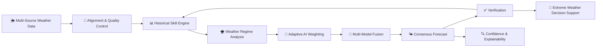
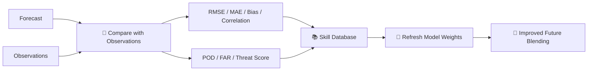
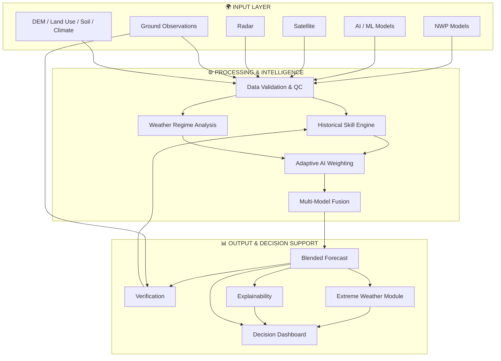
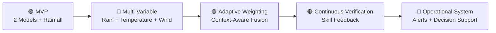

<div align="center">

# 🌦️ MERIDIAN

### Hybrid AI–NWP Multi-Model Forecast Blending System

**From Many Weather Models to One Reliable, Explainable Forecast for India.**

<p>
  
  
  
  
</p>

<p>
  <b>Adaptive weighting</b> • <b>Multi-model fusion</b> • <b>Verification</b> • <b>Explainability</b> • <b>Extreme-weather decision support</b>
</p>

</div>

---

## 🌐 What is Meridian?

Meridian is a **hybrid AI–NWP multi-model forecast blending platform** designed to combine forecasts from multiple Numerical Weather Prediction (NWP), AI/ML, regional, and ensemble models into one adaptive and explainable forecast.

Instead of trusting one model or using a fixed average, Meridian asks a more useful question:

> **Which model should we trust most for this region, this season, this lead time, and this weather regime?**

The answer is learned from historical model skill and contextual information, producing a dynamically weighted consensus forecast.

---

<div align="center">

### ⚡ One Platform. Many Models. One Adaptive Forecast.

| 🌍 Context | 🧠 Intelligence | 🌦️ Forecast | 🔍 Trust |
|:---:|:---:|:---:|:---:|
| Region | Skill-aware weighting | Rainfall | Model weights |
| Season | Meta-learning | Temperature | Confidence |
| Lead time | Model fusion | Wind | Uncertainty |
| Weather regime | Verification | Pressure | SHAP insights |

</div>

---

## 🎯 The Problem

Weather models do not perform equally well everywhere or under every condition.

Their skill can change with:

- 📍 **Region**
- 🌤️ **Season**
- ⏱️ **Forecast lead time**
- 🌪️ **Weather regime**
- 🌧️ **Forecast variable**
- 🚨 **Extreme-weather conditions**

A single model can therefore be excellent in one situation and weaker in another. Static averaging also ignores this changing context.

### The gap

```text
Single Model
     │
     ▼
 One Forecast
     │
     ├── Regional skill varies
     ├── Seasonal skill varies
     ├── Lead-time skill varies
     └── Extreme events remain difficult
```

### Meridian's answer

```text
Many Forecast Models
        │
        ▼
Historical Skill
        │
        ▼
Context Awareness
        │
        ├── Region
        ├── Season
        ├── Lead Time
        └── Weather Regime
        │
        ▼
Adaptive AI Weighting
        │
        ▼
One Blended Forecast
        │
        ▼
Verification + Explanation
```

---

# 🛰️ Forecast Intelligence Pipeline



---

## 🌦️ What Goes Into Meridian?

<div align="center">

| Source | Examples | Purpose |
|---|---|---|
| 🌍 **NWP** | IMD, ECMWF, GFS, WRF | Physics-based forecasts |
| 🤖 **AI / ML** | GraphCast, Pangu-Weather, LSTM, Transformers | Data-driven forecasts |
| 📦 **Ensembles** | GEFS and other ensembles | Spread & uncertainty |
| 🛰️ **Satellite** | INSAT, SAR | Observational context |
| 📡 **Radar** | Doppler radar | Short-range weather observations |
| 🌡️ **Ground** | Weather stations, AWS | Verification & observations |
| 🗺️ **Static Data** | DEM, land use, soil | Spatial context |
| 🌐 **Climate Indices** | ENSO, IOD, MJO | Large-scale climate context |

</div>

---

# 🧠 The Core Idea: Adaptive Weighting

Meridian does not simply average model outputs.

It dynamically learns the contribution of each model.

```text
                    ┌──────────────────────┐
                    │   Context Features   │
                    ├──────────────────────┤
                    │ Location             │
                    │ Season               │
                    │ Lead Time            │
                    │ Weather Regime       │
                    │ Recent Model Skill   │
                    │ Model Agreement      │
                    └──────────┬───────────┘
                               │
                               ▼
                    ┌──────────────────────┐
                    │   Meta-Learner       │
                    │ XGBoost / PyTorch    │
                    └──────────┬───────────┘
                               │
                               ▼
                    ┌──────────────────────┐
                    │ Dynamic Model Weights│
                    └──────────┬───────────┘
                               │
             ┌─────────────────┼─────────────────┐
             ▼                 ▼                 ▼
          ECMWF              GFS               AI Model
             │                 │                 │
             └─────────────────┼─────────────────┘
                               ▼
                    ┌──────────────────────┐
                    │  Blended Forecast    │
                    └──────────────────────┘
```

### Blending Formula

```text
F_blend = Σ (wi × Fi)
```

Where:

- `Fi` = forecast produced by model `i`
- `wi` = dynamically learned weight for model `i`

The goal is to **learn which model should be trusted under the current forecasting context**.

---

# 📊 Skill & Verification Engine

Meridian continuously evaluates model performance against observations.

### Core Metrics

| Metric | What it tells us |
|---|---|
| **RMSE** | Overall forecast error |
| **MAE** | Average absolute error |
| **Bias** | Systematic over / under prediction |
| **Correlation** | Agreement with observed variation |
| **POD** | Probability of detecting an event |
| **False Alarm Ratio** | Frequency of incorrect event alerts |
| **Threat Score** | Overall extreme-event detection skill |



---

# 🌪️ Extreme Weather Decision Support

Meridian is designed to turn forecast information into actionable weather-risk guidance.

<div align="center">

| 🚨 Event | 🔎 Analysis | 📢 Decision Support |
|---|---|---|
| 🌧️ **Heavy Rainfall** | Probability, threshold, spatial extent | Flood advisories |
| 🌀 **Cyclones** | Track, intensity, landfall risk | Cyclone guidance |
| 💨 **High Winds** | Wind probability & affected areas | High-wind alerts |
| 🔥 **Heat Waves** | Temperature anomalies | Heat-risk guidance |
| ❄️ **Cold Waves** | Temperature anomalies | Cold-risk guidance |
| 🏜️ **Drought** | Rainfall deficit, dry spells | Water & agriculture support |

</div>

---

# 🔍 Explainability

A forecast is more useful when users can understand **why** it was produced.

Meridian can expose:

```text
Model Skill
    +
Dynamic Weights
    +
Model Contribution
    +
Confidence
    +
Uncertainty
    +
SHAP Explanations
    ↓
Understandable Forecast Guidance
```

### Explainability Views

- 🧮 Model contribution
- 🗺️ Model weight maps
- 📈 Skill comparisons
- 🎯 Confidence estimates
- 🌫️ Forecast uncertainty
- 🔬 SHAP-based explanations
- ⏱️ Lead-time reliability

---

# 🖥️ Decision Dashboard

The proposed interface brings the forecasting workflow into one place.

<div align="center">

| 🗺️ Forecast Map | 📈 Time Series | ⚖️ Model Weights |
|:---:|:---:|:---:|
| Spatial forecast visualization | Location-based forecast trends | Which model is trusted? |

| 🚨 Alert Panel | 🎯 Confidence | 🔬 Model Comparison |
|:---:|:---:|:---:|
| Extreme-weather risks | Forecast reliability | Model vs blended forecast |

</div>

### Dashboard Capabilities

- Interactive weather maps
- Forecast timelines
- Model comparison
- Model weight maps
- Time-series charts
- Confidence bands
- Uncertainty visualization
- Extreme-weather alerts
- Reports and downloads
- Custom analysis and user queries

---

# 🏗️ System Architecture



---

# 🧩 Technology Stack

<div align="center">

### 🐍 Data & Processing


### 🤖 Machine Learning


### ⚡ Backend


### 🗄️ Data & Storage


### 💻 Frontend


### ☁️ Deployment & Monitoring


</div>

---

# 🚀 Phased Roadmap



### Future Extensions

- 🛰️ Satellite and radar nowcasting
- 📍 Hyper-local district-level downscaling
- 🧠 Online learning from verification feedback
- 🌀 Cyclone track and intensity prediction
- 🌫️ Air-quality forecasting
- 🔌 Open API services
- 📱 SMS / WhatsApp alerts
- 🏛️ Integration with IMD and NDMA portals

---

# 🌍 Potential Impact

Meridian is designed to support decision-making across:

| Area | Potential Use |
|---|---|
| 🚨 Disaster Management | Early warning and extreme-weather guidance |
| 🌾 Agriculture | Weather-aware agricultural planning |
| 💧 Water Management | Rainfall and drought monitoring |
| 🌊 Coastal Management | Cyclone and high-wind risk |
| 🏗️ Infrastructure | Weather-aware planning and resilience |
| 🌱 Environment | Monitoring and climate-related analysis |
| 🔬 Research | Model verification and comparison |

The intended reach is **pan-India**, with the architecture designed to support regional and national-scale forecasting workflows.

---

# 🔬 Research Foundation

The system builds upon research and established approaches in:

- Multi-model ensemble rainfall prediction
- AI-based weather forecasting
- GraphCast
- Pangu-Weather
- WeatherBench 2
- Statistical forecast post-processing
- Bayesian model averaging

---

# 📁 Project Structure

```text
Meridian/
├── frontend/
│   ├── src/
│   ├── index.html
│   ├── package.json
│   └── vite.config.ts
│
├── src/
│   ├── App.tsx
│   ├── main.tsx
│   └── index.css
│
├── .Meridian/
│   └── make/
│
├── index.html
├── package.json
├── pnpm-lock.yaml
├── tsconfig.json
├── vite.config.ts
└── README.md
```

---

# ⚙️ Getting Started

### Prerequisites

- Node.js
- pnpm
- Git

### Clone

    git clone https://github.com/shaheeq27/Meridian.git
    cd Meridian

### Install

    pnpm install

### Development

    pnpm dev

### Production Build

    pnpm build

### Preview

    pnpm preview

---

# 📌 Project Status

Meridian is being developed through a phased implementation strategy:

**MVP → Initial Model Integration → Rainfall Forecasting → Multi-Variable Forecasting → Adaptive Weighting → Continuous Verification → Operational Forecasting & Decision Support**

---

<div align="center">

## 🌦️ Smarter Forecasts. Safer Tomorrow.

### Built for Smart India Hackathon 2026.

<br>


</div>
